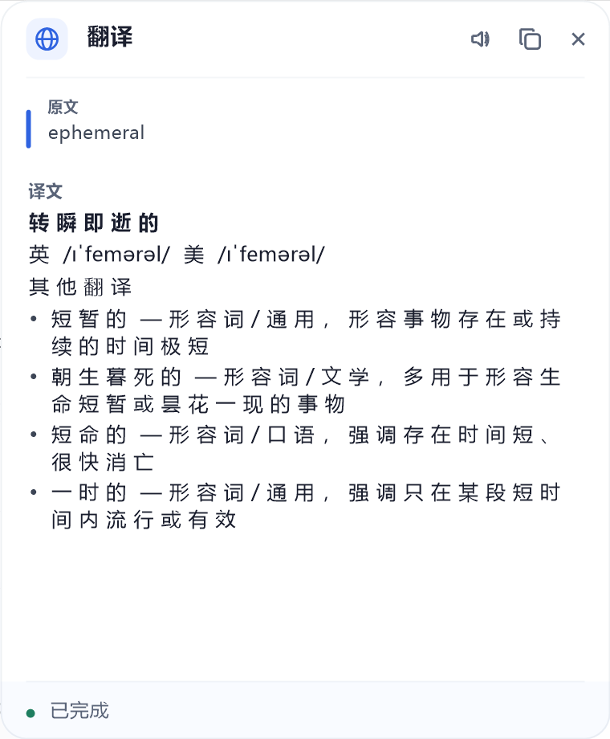
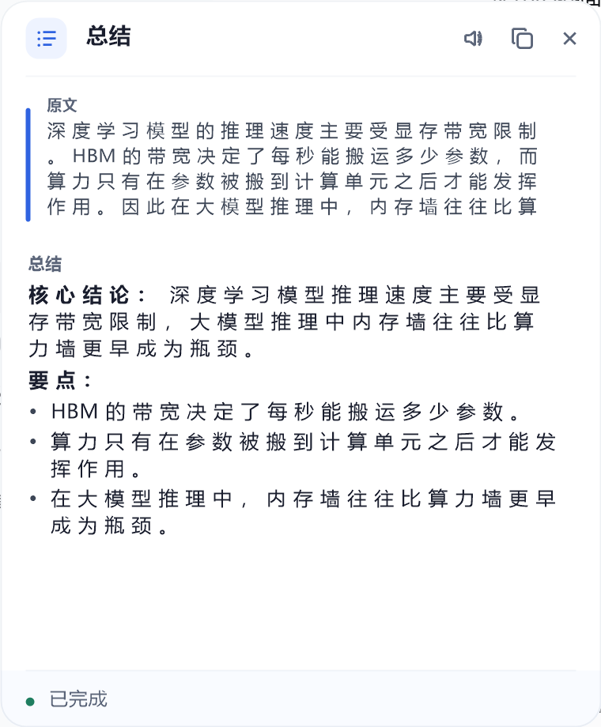
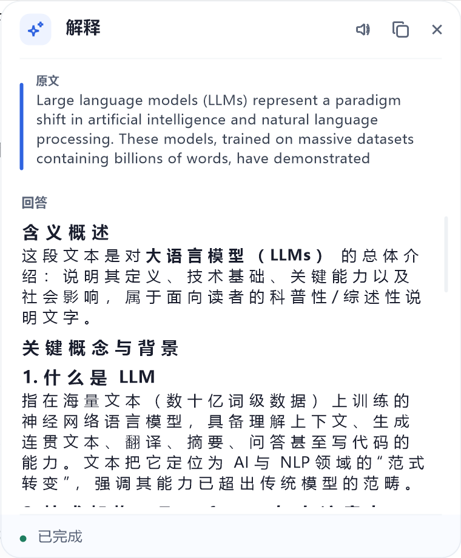
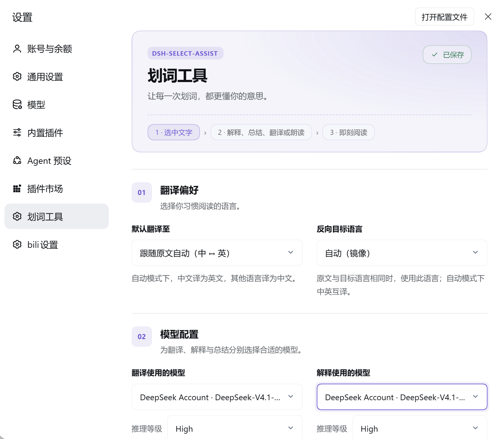
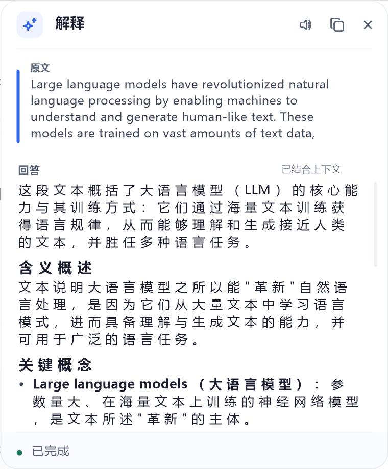
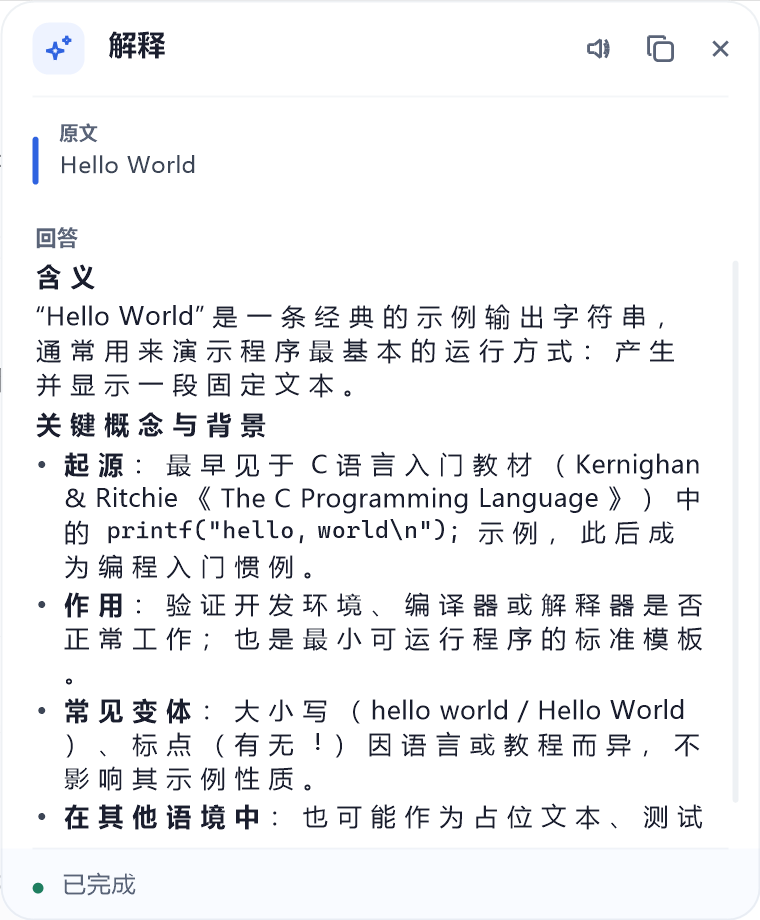
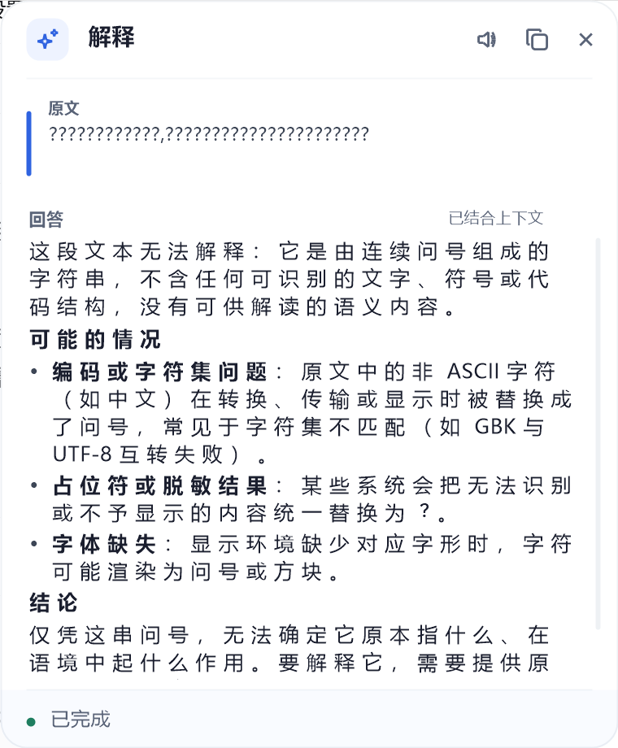

<h1 align="center">dsh-selection-tools</h1>

<p align="center">
  
  
  
  
</p>

<p align="center">划词即问：在电脑上任意应用里选中文字，用 DeepSeek Harness 自己的模型解释、总结或翻译，结果落在可拖动、可缩放的置顶浮窗里。<br>
Select text in any Windows app — the Harness model explains, summarizes, or translates it in a native, draggable, always-on-top overlay.</p>

---

> 🌐 **English** — an official-form DSH **bundle plugin** for Windows: select text in *any* app and explain, summarize, or translate it with DeepSeek Harness. The menu pops the moment you select — **selecting never touches your clipboard**: the selected text and its surrounding paragraph are read with UI Automation, and the clipboard (one injected Ctrl+C) is only used as a fallback *after* you click a menu item. The answer renders in a native GDI+ always-on-top window — no browser, no extra process, no runtime dependency. Quickstart:
> ```sh
> dsh plugin --profile web add "github:germyGao/dsh-selection-tools"
> ```
> Restart `dsh web` afterwards. The rest of this README is in Chinese.

## 它做什么

- **系统级划词**（主路径）：在**任何 Windows 应用**里拖选或双击选词 → 以选区右下角为锚点、第四象限弹出菜单（`解释` / `总结` / `翻译` / `朗读` 四段）→ 点击后弹出置顶悬浮窗，流式显示回答。
- **划词尽量不碰剪贴板**：菜单在手势落下的那一刻就弹（不再"先注入 Ctrl+C 取词、取到才弹"——那条路上取词失败就等于菜单呼不出来）；选中的文字留到**点菜单项时**才解析，先走 UI Automation 直接读选区，只有它读不到才注入一次 Ctrl+C 读剪贴板兜底。会在**弹菜单之前**碰剪贴板的情形有两类：应用对 UIA 完全说不出话（WPS 的 Qt 版这类），以及 UIA 只报出一个**空选区**——普通元素带 TextPattern 却报不出选区时不能就此下结论（WPS 的探针常常只命中功能区那样的无关文本控件，那里本来就没有选区），这两档都只能注入一次 Ctrl+C 来核实"这次手势到底有没有选中文字"（见下文），`DSH_SELECTION_CONFIRM=0` 可关掉。
- **一份选区只弹一次菜单**：菜单以任何方式收起（超时、Esc、点到别处、点了菜单项）之后，那份**旧选区还留在应用里也不会让菜单再冒出来**——只有重新划词（选出了新的一段）才会再弹。少了这条，"选中一次"之后就变成"到哪里拖菜单都会出来"。
- **菜单与回答窗口彼此独立**：划词菜单有显示时限（默认 **3.6 秒**），超时、按 Esc、或用**任意鼠标键**点到别处都会收起；回答窗口**只有手动关闭（标题栏 ✕）才会消失**——新划词不会动它，**窗口里的内容也只在点菜单项（解释/总结/翻译）时才会换**（再选一段文字、点窗口、滚轮都不会把结果顶掉）。
- **总结**：选中长段文字点「总结」，先用一句话给出核心结论，再分「要点」逐条列出关键信息；原文有明确结构（章节、列表、对话轮次）时保留大致层次再压缩。总结规则同样可在设置页改。
- **标题栏三个按钮**（从右往左：关闭 / 复制 / 朗读）：**复制**把回答写进剪贴板，页脚回执「已复制 / 复制失败」；**朗读**用 Windows 自带的语音（SAPI，进程内 COM，不起额外进程）念出选中的原文，再点一次就停，读完自动复原；没有内容可复制/没有原文可读时对应图标画成灰的。
- **翻译会分情况给结果**（由翻译规则驱动，可改）：选中的是**词/短语**时按词典条目输出——**最佳翻译**、**音标**（英/美）、**其他翻译**（带词性与使用场景）、关键术语或缩写再给**术语说明**；选中的是**句子/段落**时先给整段译文，若句中出现关键术语、缩写或专有名词，再追加**关键术语**小节逐条解释。
- **自动带上上下文**（像知乎的划词解释）：手势落下后立刻用 UI Automation 读"选区 + 选区所在的那个段落"（一次读完），点解释/总结/翻译时连同上文一起交给模型，回答落在语境里而不是孤立地解释一个词；读不到（应用不暴露 UIA 文本）就安静降级为只送选区，再读不到才退到剪贴板。
- **页内划词**（保底路径）：同一套菜单/悬浮窗也注册在 DSH 的 `shell.overlay` 槽位里；系统级能力不可用时（没装 koffi、被显式关闭）自动接管，DSH 页面内划词照常可用。页内这条路同样"一份选区只弹一次"（用选区的起点/终点位置 + 文本当签名，`selectionchange` 一变就作废）。
- **设置页**：在 DSH 的「设置 → 划词工具」里改默认翻译语言、反向目标语言、解释/总结/翻译规则（直接进提示词）、以及三种动作各自使用的模型 + 推理等级；改完立即生效（存在 `DSH_HOME/dsh-selection-tools.json`）。
- **两种回答引擎**（设置页 `engine` 切换）：
  - `direct`（默认，快）：插件直接用宿主的 `llm` 服务流式调一次模型，**不建 DSH 会话**。首字延迟约 1.2–1.3 秒、整段完成 1.5–4.5 秒，且是真流式（首字到达即渲染，实测一段 490 delta 均匀分布在 1.3–4.4 秒）。代价：没有系统提示、没有工具、划词记录不进侧栏，不能点进去追问。
  - `agent`（慢但可追问）：用 `ctx.agents` 跑一轮**真实会话回合**（同一套 agent loop、系统提示、工具、模型 route），每次划词都是一条全新会话，**跑完不归档**，会话出现在侧栏「未分组」里，可以点进去追问。代价是首字要等整轮跑完（4.3–5.5 秒）。
- **回答渲染**：系统级浮层用 GDI+ 自绘 markdown-lite（标题、列表、代码、引用、表格），页内用官方 Markdown 原语渲染。
- **零外部依赖、零额外进程**：系统级浮层是**伴生进程自己创建的原生 Win32 分层窗口 + GDI+ 自绘**——不需要 Edge/Chrome，不启动任何浏览器，不装任何运行时。颜色、圆角、图标都照 DSH 主题令牌取值。

## 界面

系统级浮层（原生窗口，GDI+ 自绘）：划词菜单 / 回答窗口

| 划词菜单（锚点第四象限） | 词/短语翻译（词典式） | 回答窗口（结合上下文） | 鼠标拖动改大小后 |
| --- | --- | --- | --- |
|  |  |  |  |

设置页（DSH 设置 → 划词工具）：



上下文的作用（同一段文本 `the P`，左：带了选区所在的段落，右：只有选区本身）：

| 结合上下文 | 只有选区 |
| --- | --- |
|  |  |

页内路径（DSH 窗口里划词，用官方 Markdown 原语渲染）：

| 对话内划词 | 结果 |
| --- | --- |
|  |  |

## 架构

```
┌─ DSH 进程 ───────────────────────────────┐      ┌─ 伴生进程（Node + koffi + GDI+） ────────┐
│ dsh-selection-tools（Cordis 插件）        │      │ 全局鼠标轮询 → 拖选 / 双击手势          │
│  · /api/dsh-selection-tools/run  (SSE)   │◀─────│ UIA 读选区+段落（不碰剪贴板）            │
│  · /api/dsh-selection-tools/stop         │ HTTP │ 原生分层窗口：菜单 / 回答窗口            │
│                                          │◀─────│ 点菜单项仍读不到才注入 Ctrl+C 兜底       │
│  · /api/dsh-selection-tools/system/*     │      │ GDI+ 自绘（圆角卡片、字体、markdown-lite）│
│  · direct: ctx.llm 流式  /  agent: ctx.agents │  └─────────────────────────────────────────┘
└──────────────────────────────────────────┘
```

- **为什么要有伴生进程**：DSH 插件跑在 dsh 进程里，拿不到全局鼠标、也起不了置顶窗口。伴生进程用 dsh **自带**的 koffi（FFI）直接调 user32/gdi32/gdiplus，不需要额外编译或安装任何东西。
- **为什么是原生窗口而不是浏览器窗口**：不依赖 Edge/Chrome（没有浏览器的机器也能用）、不额外起进程、不占几百 MB 内存；拖动/缩放由 Windows 原生处理（`WM_NCHITTEST`），圆角与阴影是分层窗口的逐像素透明，比浏览器窗口更贴合 DSH 的观感。
- **两个窗口，不是一个**：划词菜单与回答窗口是两个独立原生窗口（菜单 328×36 横向四段；回答窗口 380×460，按显示器缩放换算成物理像素）。菜单超时/被点掉都不会影响回答窗口；回答窗口没有悬浮球、也没有最小化，唯一的手动关闭入口是标题栏的 ✕。
- **上下文为什么要用 UI Automation**：要在 Windows 上通用地拿到"选区周围那段话"，又不改动用户选区、不注入额外按键、不额外起常驻进程，只有 UIA 的 TextPattern 做得到（取选区范围 → 就地扩到段落）。它的调用是同步 COM，所以放在 **worker 线程**里、带超时，卡住的宿主应用拖不住划词链路。

## 能力面

| 能力 | 说明 |
| --- | --- |
| 系统级手势检测（伴生进程） | 轮询左键状态与光标位置识别"拖选（位移 ≥5px）"与"双击选词（420ms/6px 内两次）"；落在浮层自己身上的点击忽略。 |
| 取词（伴生进程） | **主路径是 UI Automation**：手势落下就一次读完"选中的文字 + 它所在的段落"，全程不注入按键、不碰剪贴板。只有 UIA 读不到（应用不暴露文本、超时）才退到剪贴板兜底——那次注入 Ctrl+C 会**用剪贴板序号变化判定是否真的复制成功**，并核对这次写入不是别的进程写的，随后把用户原来的剪贴板内容还原；**用户正按着 Ctrl+C、或用户在取词期间自己复制过，就一个字节都不碰剪贴板**；控制台/终端窗口默认跳过（Ctrl+C 在那里是中断）。取词的取舍每次都会记进 `/status` 的 `lastCapture` 与 `lastResolve`。 |
| 原生浮层（伴生进程） | 自己创建 `WS_POPUP` + `WS_EX_LAYERED|TOPMOST|TOOLWINDOW|NOACTIVATE` 窗口，GDI+ 画一帧到 32bpp DIB，`UpdateLayeredWindow` 带 alpha 贴屏；无边框、置顶、不抢焦点。 |
| 交互 | 标题栏拖动、**四边四角缩放**（八个方向都能用鼠标拉，指针会变成对应的双箭头）、菜单两项 hover/点击、回答窗口的复制/关闭/停止、滚轮滚动、全局 Esc 收起菜单。 |
| 选区 + 上下文（伴生进程） | 手势落下后用 UI Automation 一次读完**选区**与选区所在的**段落**（TextUnit_Paragraph）；候选元素按"点上的元素 → 逐级祖先 → 焦点元素 → 逐级祖先"找（浏览器里点上的常常只是外壳），**第一次读不到会等 160ms 再读**（Chromium 这类应用是被 UIA 问到才打开无障碍树，冷启动第一次必失败——实测 DSH 桌面端自己的 WebView2 窗口也一样）；读不到/超时一律按"没有选区"处理，交给点菜单项之后的解析链继续。 |
| 朗读（伴生进程） | 进程内 COM 调 `ISpVoice`（`Speak` 异步 + `WaitUntilDone(0)` 轮询"还在读吗"），读的是选中的原文；面板关闭、开始新一轮、再点一次都会停。 |
| `POST /api/dsh-selection-tools/run` | 同源 JSON 进、**SSE 出**（`session`/`delta`/`done`/`error`）。`engine=direct`（默认）走 `ctx.llm` 直连流式，`engine=agent` 走真实 agent 回合。 |
| `POST /api/dsh-selection-tools/stop` | 停止当前一轮：直连请求走 `AbortController`，agent 请求走官方 `agent.cancel({ kind: 'user' })`。 |
| `GET /api/dsh-selection-tools/system/status` / `POST .../system/restart` | 伴生进程状态 / 重启（诊断用）；重启会**等老进程真的退出**再拉起新的，不留幽灵进程。 |
| 页内菜单 + 悬浮窗（客户端） | 注册进 `shell.overlay`；系统级接管时自动让位。 |

> 不注册任何模型可见的工具，也不改官方源码。

## 安装

本仓库根目录就是一个 **bundle 插件包**（`package.json#dsh.bundle` → `cordis.patch.yml`），且**构建产物已入库**（`lib/`）——git 源安装不需要任何构建步骤。

```sh
# GitHub 一行装（推荐）
dsh plugin --profile web add "github:germyGao/dsh-selection-tools"

# 本地检出目录
cd <本仓库路径>
dsh plugin --profile web add .

# npm（发布后）
dsh plugin --profile web add dsh-selection-tools
```

装完**重启 `dsh web`**（或重启承载它的桌面端）生效——bundle 层栈在启动时合成。卸载 / 更新：

```sh
dsh plugin --profile web remove dsh-selection-tools
dsh plugin --profile web update
```

自检：

```sh
curl http://127.0.0.1:3080/api/dsh-selection-tools/ping
curl http://127.0.0.1:3080/api/dsh-selection-tools/system/status   # companion.state 应为 running
```

只改伴生进程/浮层时，不必重启 DSH：

```sh
curl -X POST http://127.0.0.1:3080/api/dsh-selection-tools/system/restart
```

## 使用

1. **任意应用**里选中文字（拖选 / 双击选词）——这一步不碰剪贴板。
2. 选区右下角弹出菜单（大约几十毫秒后就可见；`DSH_SELECTION_MENU_DECIDE_MS` 说明见下），点 **解释**、**总结**、**翻译** 或 **朗读**（Esc 可收起）。
3. 回答窗口先显示「正在读取选区…」，随即流式显示结果（带着选区所在的上下文一起问）；生成中可 **停止**，完成后可 **复制** 或 **关闭**（✕）；**标题栏可拖动，四条边与四个角都能用鼠标拖着改大小**（指针会变成对应的双箭头）。取不到选中的文字时会显示「失败 · 未能读取选中的文字」，而不是"点了没反应"。

翻译方向自动判定：源文本含中日韩字符 → 译成英文；否则译成中文。

## 开关与配置（环境变量）

| 变量 | 默认 | 说明 |
| --- | --- | --- |
| `DSH_SELECTION_DISABLE_SYSTEM` | 未设置 | 设为 `1` 关闭系统级划词（保留页内划词，伴生进程不再启动）。 |
| `DSH_SELECTION_HOOK` | `1` | 伴生进程侧开关：`0` = 只起浮层不做全局手势检测。 |
| `DSH_SELECTION_POLL_MS` | `40` | 鼠标轮询间隔（毫秒）。 |
| `DSH_SELECTION_MAX_TEXT` | `12000` | 单次划词字符上限。 |
| `DSH_SELECTION_MENU_DECIDE_MS` | `280` | 手势落下后给 UIA 的决策窗口：这么长时间内读到"有没有选中文字"就按它办（有选区 → 弹；落在桌面/任务栏这类系统外壳上 → 不弹；**普通元素报出空选区** → 不表态，交给剪贴板核实）；超时就**再宽限三倍时长（上限 1s）**等探针的结论（探针还在跑，只是慢），宽限也用完才按"未知"照弹（`0` = 手势一到就弹，不做任何过滤）。 |
| `DSH_SELECTION_TEXT_SOURCE` | `auto` | 选区文字从哪来：`auto` = UIA 优先、读不到才用剪贴板；`uia` = 只用 UIA（读不到就报错，绝不碰剪贴板）；`clipboard` = 直接用剪贴板（某个应用 UIA 读得不准时的逃生舱）。 |
| `DSH_SELECTION_MENU_PROBE_RETRIES` | `3` | 菜单弹出时 UIA 预读的重试次数（Chromium/WebView2 冷启动第一次必失败，重试同时替后面的解析把无障碍树焐热）。 |
| `DSH_SELECTION_PRESS_PROBE` | `1` | 鼠标**按下**时要不要拍一张"手势之前的选区"快照：只有它能把"拖动一个已选中的元素"（WPS/Office 的 PPT 形状、Excel 单元格）和"拖选文字"分开。`0` = 不拍（每次按下少一次 UIA 读取，代价是拖动已选中的元素又会弹菜单）。 |
| `DSH_SELECTION_PRESS_WAIT_MS` | `120` | 等这张按下快照的上限（毫秒）：正常早就回来了，只有"按下到松开特别快"的拖拽才会真等；超时按"没拍到"处理。 |
| `DSH_SELECTION_CONFIRM` | `1` | UIA 说不出话、或只报出一个空选区时（WPS/Office 的 Qt 版这类不暴露文档文本的应用），要不要用**剪贴板**核实"这次手势到底有没有选中文字"：注入一次 Ctrl+C，真选中文字就会复制出文字，拖动形状/窗口则什么都复制不出来。核实还挡掉两种"复制出来的是文字、但其实没在选文字"的情形：表格网格里的选区（`XLMAIN` + `EXCEL7`，**注入 Ctrl+C 之前**就挡掉，不让这一下搅乱复制模式）和剪贴板里挂着原生表格格式（`WPS Spreadsheets … Format` / `XML Spreadsheet` / `Biff*`）的复制。`0` = 不核实（退回老行为：拖选照弹、双击不弹）。 |
| `DSH_SELECTION_CLICK_PROBE_RETRIES` | `1` | 点菜单项时补读 UIA 的重试次数；再多只是拖延剪贴板兜底。 |
| `DSH_SELECTION_CLIPBOARD_OWNER` | `1` | 取词时是否核对"这次剪贴板写入不是别的进程写的"；`0` = 退回老行为（只看序号变化）——核对误伤了某个应用、取不到词时才关。 |
| `DSH_SELECTION_MENU_TIMEOUT_MS` | `3600` | 划词菜单的显示时限（毫秒）。 |
| `DSH_SELECTION_CONTEXT` | `1` | UI Automation 开关；`0` = 关掉"读选区 + 读段落"（菜单不再过滤手势，选区只能走剪贴板兜底，等于退回老行为）。 |
| `DSH_SELECTION_CONTEXT_TIMEOUT_MS` | `1800` | 单次 UIA 读取的时间预算；超时直接丢掉 worker。 |
| `DSH_SELECTION_LOCALE` | 由插件传入 | 回答语言提示（`zh`/`en`）。 |
| `DSH_SELECTION_DSH_ORIGIN` | `http://127.0.0.1:3080` | 伴生进程调用 DSH 路由的地址（插件自动传对）。 |

## 设计要点（含踩过的坑）

- **菜单绝不能等取词**：老实现是「手势 → 注入 Ctrl+C 读剪贴板 → 读到了才弹菜单」，于是**取词失败就等于菜单呼不出来**——DSH 桌面端自己的 WebView2 窗口里注入的 Ctrl+C 拿不到剪贴板（实测 `/status` 里 `lastCapture.reason = timeout`，剪贴板序号变了却读不出文字），个别外部应用也偶发。它还会短暂接管用户的剪贴板。现在手势落下就弹菜单，弹出条件里再也没有「能不能取到词」这一项；代价是要自己回答「这次拖拽/双击到底是不是在选文字」，用 UIA 回答（`companion/policy.mjs` 的 `menuDecision`）：
  - 读到选区里有文字、**而且按下的地方就在这段选区里** → 弹（这次手势选的就是它）；
  - 读到选区里有文字，但按下的地方不在选区里 → **不弹**（`stale-selection`）：那是**上一次划词留下的旧选区**，菜单已经为它弹过一次、也已经收起；
  - 落在桌面/任务栏这类不含可选文本的系统外壳上 → **不弹**（`shell`）：拖桌面、双击图标都不该弹；
  - 普通元素带 TextPattern 却报不出选区 → **不表态**（`unknown`），交给剪贴板核实（原因见下一条）：WPS 的探针常常只命中功能区那样的无关文本控件，那里本来就没有选区，就此判成"没在选文字"会把真划词一起误杀——拖窗口、拖滑块最终仍会因为复制不到文字而不弹；
  - **按下时读到的就是这一段、松开时还是它** → **不弹**（`unchanged-selection`）：这次手势压根没改动选区。办公套件里最典型——WPS/Office 的 PPT 里选中一个形状/文本框再拖动它、Excel 里拖一个已选中的单元格/图表，UIA 从按下到松开一路都报着"这个对象被选中"（按下点和松开点当然都落在元素里），只看松开那一刻就会在用户**移动元素**时冒出菜单。判据是按下那一刻拍的快照（`pressProbe`，`DSH_SELECTION_PRESS_PROBE` 可关）；
  - 什么都没读到（应用不暴露 UIA 文本、宽限期也用完）→ **不表态**（`open: null`），同样交给**剪贴板核实**（见下一条）。
  这几条都有单测钉着（`test/policy.test.mjs`），决策理由每次写进 `/status` 的 `lastMenuDecision`。
- **UIA 说不出话时，只能让剪贴板说话**（WPS/Office 的 Qt 版这一整类应用）：实测把 WPS PPT 的 UIA 树整棵走一遍（376 个节点），带 TextPattern 的只有功能区的两个长条文本框——**幻灯片里的文字、形状、选区，UIA 一个字都读不到**。于是"这一点上有没有选中文字"这个问题，UIA 永远答"不知道"：拖动一个已选中的形状/文本框、拖窗口标题栏、拖画布，全都落进"读不到"那一档，而那一档原本是**照弹**的（`reason=unknown`）——用户看到的就是"选中元素并拖动也弹菜单"；双击则落在同一档的另一面（不弹），于是"双击选词也呼不出来"。
  另一条进这一档的路是"普通元素报出空选区"（上面的 `unknown`）：WPS 的探针可能只命中了功能区，那里本来就报不出选区，所以"空选区"同样不能当作"没在选文字"。
  现在这一档改成 **`open: null`（不表态）**，由 `main.mjs` 的 `confirmByClipboard` 用剪贴板核实一次：注入一次 Ctrl+C——
  - **真选中了文字** → 复制出文字 → 弹菜单（`reason=clipboard`），顺手把这文字记进这次选区，点菜单项时不用再复制一遍；
  - **表格网格里的选区**（前台是 `XLMAIN`、焦点控件是 `EXCEL7`）→ **连 Ctrl+C 都不注入**就判不弹（`lastConfirm.reason=not-text-editing`）：那一下会真的触发一次复制、还会搅乱 WPS/Excel 的复制模式，而网格选区本来就不是"文字编辑"；
  - **剪贴板里挂着原生表格格式**（`WPS Spreadsheets … Format` / `XML Spreadsheet` / `Biff*`）→ **不弹**（`lastConfirm.reason=non-text-selection`）：单元格区域和嵌入对象也会在剪贴板里挂一份纯文本，光看"有没有复制出文字"分不开，所以改用剪贴板自己的**原生对象格式**当证据（`HTML Format` / `Rich Text Format` 单独出现仍算正常富文本）；
  - **拖动形状/窗口** → 什么文字都复制不出来 → **不弹**（`reason=unconfirmed`）——这就是"拖动元素不再弹菜单"的判据；
  - **核不出来**（终端窗口、用户此刻正按着 Ctrl+C、或者 `DSH_SELECTION_CONFIRM=0`）→ 退回老行为（拖选照弹、双击不弹，见 `policy.mjs` 的 `unknownFallback`）。
  注意上面前三种"不弹"在决策里都记成 `reason=unconfirmed`，"到底栽在哪一条"看 `/status` 的 `lastConfirm.reason`。
  代价与安全边界全交给 `selection.mjs`：只在前台窗口确实是 UIA 说不出话、或只报空选区的应用里才注入；用户正按 Ctrl+C 就一次都不注入；只认前台窗口自己写的那次（**唯一例外**见下）；读完把用户原来的剪贴板内容放回去。**额外一条**：这次注入是我们自己发的，所以"一个字都没复制出来"时也要把用户原来的文字放回去（`restoreWhenEmpty`）——否则拖动一个形状就会把用户的剪贴板悄悄换成那个形状。
  - **唯一例外是 WPS 自己的文档进程**：WPS 把文档引擎放在**独立进程**里，复制时用的是它一个**无属主、隐藏的 `CLIPBRDWNDCLASS`** 窗口，两个进程都不在前台窗口那棵窗口树里，严格按"同一个窗口树"判会把它当"别人写的"而丢掉。所以 `ownerRelation` 放行这一种：前台和写入方都是**同一套 WPS 安装目录**下的文档进程（`wps.exe` / `et.exe` / `wpp.exe`，按可执行文件所在目录比）。认不出的进程、别的安装目录、以及类名不是 `CLIPBRDWNDCLASS` 的窗口，一律照旧算 `foreign`（`test/selection.test.mjs` 钉着这两面）。
- **`unchanged-selection` 与剪贴板核实是两条互补的路**：前者管"UIA 读得到选区、但用户其实在移动一个已选中的元素"（Office 的 UIA 版、LibreOffice 这类），后者管"UIA 完全读不到、或者只报得出一个说不清来历的空选区，只能靠复制来问"（WPS 的 Qt 版）。两条都在，才既不误弹也不吞划词。
- **“这次手势有没有选出新东西”只能在按下的那一刻量**：拖动一个**已经选中**的元素时，UIA 给出的选区跟真划词一模一样（都是“这一段被选中了”，按下点/松开点也都在选区里），唯一的差别是**拖之前它就选中了、拖完还是它**。所以快照必须在按下时拍（`gesture.mjs` 的 `onPress` → `main.mjs` 的 `startPressProbe`）：拖完再读到的已经是被这次手势改过的选区了，问不出“本来是什么”。两个配套细节：
  - **双击的第二下不重拍**（`onPress.second`）：双击要的是**这一串点击开始之前**的选区（第一下按下时，文本应用会把旧选区收成插入符），第二下时选中的词已经出来了，拿它当“之前”会把双击选词整个判成“没改动”。
  - **决策在途时不拍**（`main.mjs` 的 `deciding`）：读取器同一时刻只保留最新的一次请求，决策等结论时再拍一张会把**这次决策的探针**顶掉（结果变成“读不到”），菜单反而会在随手一拖时冒出来。那一档按“没拍到”处理，判定完全退回改动前的行为。
  - 拍不到（应用不响应、按下到松开特别快、`DSH_SELECTION_PRESS_PROBE=0`）时的取舍是**照弹**：宁可偶尔多弹一次，也不能因为多拍一张快照而吞掉正常划词。`/status` 的 `pressProbe` 与 `recentDecisions[].pressProbe` 会说清这张快照拍到了什么。
- **“手势碰到这段选区了吗”必须用矩形量，而且余量要按行高走**：先用 `GetBoundingRectangles` 拿选区的屏幕矩形（`RangeFromPoint` 不行——它会把点**就近吸附**到文本边界上，鼠标按在桌面空白处也照样回一个“选区最后一个字符”的位置，这个判断就永远为真、什么都量不出来）。判定本身抽成纯函数 `pointNearRects`：**余量取 `max(8, 矩形高度)`**——拖选的锚点会吸附到字符边界，字符有多宽误差就能有多大，**150% 缩放下一个字 15–30px**，写死 8px 会把“从右往左拖”“按在行尾空白处起手”这类正常划词误判成旧选区（用户报的“经常弹不出来”就是这条）。**按下点与松开点都要看**：它们是选区的两端，用户从文字里起手一路拖到段落外面（或反过来）时，总有一端落在选区里。以及一个坑：`GetBoundingRectangles` 交出来的矩形是 `{left, top, right, bottom}`，**没有 height 字段**——早期实现读 `rect.height` 得到 `undefined`，`Math.max(8, undefined)` 是 `NaN`，比较全 false，于是“手势碰到选区了吗”恒为 false、正常划词全被当成旧选区吃掉（`test/policy.test.mjs` 现在钉着这条）。 另外两个实现细节：矩形是 `SAFEARRAY(double)`（每 4 个一组 x/y/w/h），`SafeArrayAccessData` 之后按 `double` 数组解码；**槽位号必须对着 IDL 数**——`IUIAutomationTextPattern` 里 `RangeFromPoint` 排在 `RangeFromChild` 前面（3/4），`IUIAutomationTextRange` 里 `GetBoundingRectangles` 是 10，数错一位把调用打到隔壁方法上会直接 ACCESS_VIOLATION 崩掉伴生进程（实测踩过）。
- **宽限期是为了"慢"，不是为了"读不到"**：探针正常 10–30ms 就回来；慢的那一次（跨进程 provider、无障碍树刚被焐热）如果直接按"未知"照弹，用户随手一拖就会撞出菜单来。所以决策分两级：先等 `DSH_SELECTION_MENU_DECIDE_MS`，超时再等它三倍时长（上限 1s）——结论一回来就出菜单，只是比"照弹"更晚一点，而不会把旧选区或没选字的手势也弹出来。
- **选区文字 UIA 优先、剪贴板垫底**：点菜单项时才解析选区——先等菜单弹出时就开始的 UIA 预读（一次调用同时拿到**选区**与**段落**），再补读一次（那时无障碍树已热），最后才注入 Ctrl+C 读剪贴板。`/status` 的 `lastResolve.source` 会说清这次用的是哪一条（`uia-prefetch` / `uia-fresh` / `preset` / `clipboard-confirm` / `clipboard`）。**会碰用户剪贴板的地方一共两处**：这里是"点了菜单项之后还读不到文字"，另一处是"UIA 说不出话时用剪贴板核实这次手势选没选中文字"（见上，`DSH_SELECTION_CONFIRM=0` 可关）。
  - 顺带一个观察：Chromium（含 DSH 桌面端自己的 WebView2 窗口）是**被 UIA 问到才打开无障碍树**，刚启动那一下连 TextPattern 都还没有（实测：本轮第一次划词的 3 次尝试全空，之后再问就正常）。所以预读的重试次数比决策窗口长——它在替"点菜单项时"把树焐热；读不到时决策会走"未知 → 照弹"，用户不会因此丢菜单。
- **注入按键要带扫描码**：`keybd_event` 的 `bScan` 传 0 时，Chromium/WebView2 一类窗口可能不认这次合成按键，剪贴板一动都不动。兜底取词现在用 `MapVirtualKeyW` 补上扫描码，那条路才真的能兜底。
- **直连路径的首字延迟实测**：`engine=direct` 下 `llm.stream` 的第一个 `text-delta` 约在 1.2–1.3 秒到达，整段 1.5–4.5 秒完成；一段 490 delta 的输出在 1.3–4.4 秒间均匀分布（按 200ms 分桶每桶 24–44 条），确认是真流式而不是攒批。`/stop` 打到直连请求时会 `abort()` 那个 `AbortController`，SSE 立刻收到 `error: Request was aborted`。
- **agent 一致性靠复用**：`ctx.agents.create` + `agent.followup` + `agent.whenIdle`，最终文本取自语料权威来源（会话日志里最后一条 `assistant/message`）。
- **user 消息必须带稳定 `id` 与 `source.rpcId`**：缺失会让会话在 DSH 对话视图里报 `received more than one start Match`。
- **会话必须带 `cwd`**：没有工作目录的会话上跑 agent 会静默无输出。
- **侧栏分组的真实规则**（决定了"会话出现在哪"）：归档集合 `workspaceRegistry.archivedSessionIds` 里的会话在**所有视图**里都不显示（`sessionVisible = origin !== 'subagent' && !archived && (!blank || 当前会话)`）；其余会话按"是否被某个 workspace 记录的 `sessionIds` 记账"分到项目下，没被记账的才是「未分组」。所以"放进未分组" = **不归档 + 不被任何项目 attach**：本插件只走 `ctx.agents.create`（不经网关的 `session.create(workspaceId)`，那条路径会 `attachSession`），并在会话建好后 best-effort `detachSession` 兜底。宿主公开 API 只有 `archiveSession`，没有 unarchive。
- **koffi 从 dsh 安装目录解析**：插件把宿主进程的 `argv[1]` 作为锚点传给伴生进程；插件自身不 import 任何 `@deepseek-ai/*`，否则以 `link:`/本地路径安装时会因跨盘符解析失败让整个 `dsh web` 起不来。
- **koffi 的坑**：回调必须用 `koffi.proto` 先声明原型（裸字符串会报 `Unexpected character '(' in type specifier`），且被回调引用的结构体也要先定义；`SetWindowPos` 的 `hWndInsertAfter` 声明成 `intptr_t`（`HWND_TOPMOST=-1` 传给 `void *` 会被拒）；出参结构体要写 `_Out_`；`CreateCompatibleDC/BitBlt` 在 **gdi32** 不在 user32；koffi 的类型名是全局的，重复定义同名字会报 `Duplicate type name`（因此所有绑定模块都只建一次）。
- **伴生进程必须声明 DPI 感知**：不声明时 Windows 把它当 DPI-unaware，坐标全落在被缩放的虚拟空间（实测 `GetSystemMetrics` 谎报 96dpi、虚拟屏幕 3627×1080，真实是 144dpi / 4480×1600），主副屏表现会不一致。现在启动第一件事就是 `SetProcessDpiAwarenessContext(PER_MONITOR_AWARE_V2)`，尺寸按目标显示器的 `GetDpiForMonitor` 换算。
- **伴生进程的重启要"干净"**：`/system/restart` 走 `companion.restart()`——先送走老进程、**等它真的退出**再拉起新的。三处细节缺一个就会留下"幽灵伴生进程"：两个进程各自钩一次全局鼠标、各自开一个浮层，用户看到两个菜单、两个回答窗口，而插件自己只认得新的那一个。
  - `kill()` 偶尔漏杀：宽限期（默认 800ms）内还活着就直接 `taskkill /pid <pid> /T /F` 补刀。
  - exit 回调要**认身份**（`child !== spawned` 直接 return）：老进程迟到的 exit 会把**新**进程的引用与状态一起抹掉（表现是重启后状态莫名变 `stopped`）。
  - `stopping` 必须在 restart 里复位：它只在 `stop()` 里置位，不复位看门狗就永久失效（重启之后伴生进程再崩也不会自动起来）。
  - 这三条都有单测钉着：`test/companion-manager.test.mjs`（注入 `spawnChild` 起真进程 + 假僵尸，退避与宽限可注入；反证过：把任一条改回去测试立刻红）。
- **浮层页面脚本/文本渲染**：自绘的 markdown-lite 渲染器要自己处理标题级别、列表、代码块、粗体与 CJK 断行；标题正则必须把井号捕获成组（`^(#{1,4})[ ]+(.*)$`），写成 `^#{1,4}...` 时 `{1,4}` 是量词、正文会取到 `undefined`。
- **状态对象要就地合并**：绘制回调里回写的 `contentHeight`/`stopBox` 必须落到调用方持有的同一个对象上，否则滚动条与"停止"命中框永远是空的。
- **取词不能拿"剪贴板序号变了"就当成功**：剪贴板是全局的，用户自己在同一时间按 Ctrl+C、剪贴板管理器同步、别的应用复制，都会让它变。老实现把这些全当成"这次选区"，于是菜单与回答窗口拿着一整段跟选区无关的文字弹出来；更糟的是它取完词就"还原"，把用户刚复制的内容踩掉。现在的三条规则（`companion/selection.mjs`）：
  - **用户此刻正按着 Ctrl+C → 一次都不注入**。我们注入的 Ctrl 抬起事件会把用户那个还没松开的组合键拆散（应用看到的是"一个没有 Ctrl 的 c"），而"还原"又会踩掉用户那次复制的成果——两条加起来就是"按了 Ctrl+C 却粘贴出旧内容"。
  - **确定是别的进程写的那次 → 丢掉，继续等**（真正那次复制通常紧跟其后）。判据是剪贴板属主窗口的进程；UWP 那种"前台是框架窗口、真正复制的是它的子窗口"按顶层祖先的进程认成一家人。**认不出属主时放行**——环境事实：实测本机剪贴板里上一次复制的内容就是"无属主"的（写入进程已退出/无窗口写入），一律拒绝会让个别应用再也弹不出菜单（所以默认放行）。
  - **还原只在"读完之后没人再写过、且用户没在此期间自己复制过"时才做**；没取到词时一律不还原（那会儿剪贴板里可能是别人刚写的东西）。
- **两次取词绝不能重叠**：取词要注入按键 + 读同一个全局剪贴板。重叠时，后一次注入引起的序号变化会被前一次的轮询读到，前一次迟到的"还原"也会正好写在后一次的轮询窗口里——这是"回答窗口里的输入内容与选中文字不符"的另一条来路。所以手势进 `createLatestQueue`（`companion/gesture.mjs`）：同一时刻只跑一个，排队只留最新一次，跑完发现已经有新手势进来就直接丢掉结果（不弹菜单）。
- **菜单要绑定"它自己那次选区"**：点菜单项时不能现读全局的 `state.selection`——用户点下去的那一刻可能刚好又有一次划词完成，于是"回答窗口里的输入内容"跟"用户看着菜单点的那段文字"对不上。`showMenu` 把选区存进 `menu.selection`，点菜单项（含 `/click` 验收端点）一律用它。
- 取词这三条与队列都有单测钉着：`test/selection.test.mjs` 用假 Win32 造出"用户自己按 Ctrl+C""别的进程写剪贴板""我们刚读完就被人写""注入没人响应"这些时序，`test/gesture.test.mjs` 钉队列；反证过：把任一条改回老行为，测试立刻红。
- **回答窗口的状态只归它自己**：`showMenu` 里任何一次 `ui.xxx = …` 都会在窗口下一次重绘时生效——早期版本在这里顺手重置了 `ui.source/answer/status`，于是"新划词后点一下窗口"就变成"显示新选中的文字 + 没有文本输出 + 就绪"。现在弹菜单只写 `state.selection`，窗口内容只在 `startRun` 里换（踩过，用户截图就是这个现象）。
- **浏览器里第一次读上下文必然失败**：Chromium 是"被 UIA 问到才打开无障碍树"，冷启动那一刻 `GetCurrentPatternAs(TextPattern)` 拿不到东西（实测：第 0 次 `no text pattern`，第 1 次开始 selection/段落都正常）。所以 worker 里读失败要**等一下重试**（2 次 × 160ms），并且**别只看点上的元素**——点上的往往是外壳，得沿控制视图往上一层层找 TextPattern。
- **SAPI 的 vtable 要按继承顺序数**：`ISpVoice` 继承 `ISpEventSource` ← `ISpNotifySource` ← `IUnknown`，所以 `Speak`=20、`SetRate`=28、`SetVolume`=30、`WaitUntilDone`=32（IDL 里每个接口都从 3 开始编号，直接照抄会打错函数）。
- **设置要能被模型真的用上**：语言/规则/模型座位都在宿主半边的 `dsh-selection-tools.json` 里，跑一轮前现读；模型座位优先级 = 设置里的座位 > 请求带的 provider/model > 部署默认。验证方式很干脆：把座位改成不存在的模型，那一轮必须失败（否则说明设置没被用）。
- **布局必须按窗口实际尺寸算**：回答窗口可以被用户用鼠标拖着改大小，`paintPanel`/`panelLayout`/`panelButtons`/`panelHit`/`panelEdgeZone`/`panelHitZone` 全部要拿**实际**宽高（物理 ÷ 缩放 = DIP），不能钉死 `MODES.panel` 的 380×460（踩过：改完大小后正文/页脚还按老尺寸排版，窗口下方留一大片空白，缩放手柄也跑偏）。
- **八个方向都要能拉**：缩放手柄是 `panelEdgeZone` 算出来的纯几何（**边 6 DIP / 角 16 DIP**），交给 `WM_NCHITTEST` 的 HT 边框代码，剩下的活由 Windows 自己干（窗口是 `WS_POPUP`、没有 `WS_THICKFRAME`，照样能拉）。三处必须一起对，否则"某条边拉不动"：
  - **角要比边宽**：窗口圆角 16 DIP，最角落那几个像素画出来是透明的，而分层窗口的透明像素**不接收鼠标**——角区窄了就等于抓不住（左上/右上尤其明显）。
  - **上边只占最外面 6 DIP**：再往下就是标题栏，要留给 `HTCAPTION` 拖动（早先版本整条上边都判成拖动区，所以上边"拉不动"；把 `HTTOP` 铺满整个标题栏又会反过来拖不动窗口）。
  - **按钮优先**：缩放手柄就压在标题栏按钮与页脚「停止」旁边（上右角贴着关闭按钮、底边贴着「停止」），命中顺序必须是 按钮/「停止」 > 手柄 > 拖动 > 客户区，否则这两个按钮的边角会被手柄抢走。
  - 指针形状自己换（`WM_SETCURSOR` + `RESIZE_CURSORS`）：类光标是 null，无边框弹窗上别指望 DefWindowProc 给出拉伸指针；"这条边能不能拉"全靠指针告诉用户。
  - 命中区是纯函数，所以有单测钉着：`test/panel-zone.test.mjs` 覆盖八个方向、按钮优先、以及"按实际尺寸算"这几条。
- **`WM_SIZE` 在创建期也会来**：`CreateWindowExW` 用的是 10×10 占位尺寸，创建期/隐藏期的 `WM_SIZE` 不能当作用户改过大小——否则会把 10×10 记成"用户尺寸"，回答窗口直接以 10×10 打开（踩过）。现在只在可见状态且超过下限时才记录，并顺手同步 `panel.rect`（命中判断与 `/capture` 都依赖它）。
- **缩放要有下限**：处理 `WM_GETMINMAXINFO` 写 `ptMinTrackSize`（260×200 DIP × 缩放），否则能被拖成一条线，布局就没法看了。
- **GDI+ 裁剪的合并模式**：见下条；另外 **koffi 3.2 里 `koffi.decode(bstr, 'const char16_t *')` 会直接把进程打成 ACCESS_VIOLATION**（UIA 的 BSTR 出参踩过）。稳定做法是先读 BSTR 头部 4 字节长度、再按 `char16_t` 数组解。裸 COM 调用靠 `koffi.call(函数指针, koffi.proto(...), ...)`，vtable 槽位序号必须对着 Windows SDK 的 `UIAutomationClient.idl` 数（`ElementFromPoint`=7、`GetCurrentPatternAs`=14、`GetSelection`=5、`ExpandToEnclosingUnit`=6、`GetText`=12）。
- **同步 COM 必须隔离到 worker**：UIA 的调用是同步的，目标应用无响应时会把调用线程一起卡住。读上下文跑在 worker 线程里并带超时（默认 900ms，`DSH_SELECTION_CONTEXT_TIMEOUT_MS`），超时直接 terminate 重建——主进程的取词/菜单/绘制不受影响。
- **矩形命中判断不要跨模块复用不同形状**：手势状态机里的 `pointInRect` 吃的是 `{left,right,top,bottom}`，而窗口用的是 `{x,y,width,height}`。混用后"点在菜单内吗"恒为 false，于是**按下鼠标左键的那一瞬间**外层就按"点了别处"把菜单收起（`outside-click`），菜单项永远等不到 `WM_LBUTTONUP`——表现就是"点菜单项没反应、菜单还消失了"。现在 `main.mjs` 自己带一个 `inRect(point, rect)`（`x/y/width/height`），命中路径不再跨模块借形状。
- **GDI+ 裁剪的合并模式**：`GdipSetClipRect` 的最后一位是 `GpCombineMode`，`Replace=0`、`Exclude=4`。把 `Replace` 写成 `4` 时裁剪区变成"这块矩形**之外**"，正文正好整块被裁掉——**画面只剩标题、原文框和状态条，正文一片空白**，而"正文没有溢到页脚"看起来还像是测试通过（假绿灯）。现在固定传 `0`，并在返回状态非 0 时直接抛错。
- **表格单元格要走 `paragraph` 而不是单行 `text`**：`tokenize` 才会解析 `**粗体**` 与反引号行内码，直接 `text` 会把 `**` 原样画出来。分隔线 `---` 现在按 `hr` 块画成一条细分隔线，不再把字符当正文。

## 风险与边界

- **划词尽量不碰剪贴板**：选中的文字优先用 UI Automation 读。只有在**点了菜单项之后** UIA 仍读不到时，才会注入一次 Ctrl+C 读剪贴板（随后把原内容写回）——那一次里，用户此刻正按着 Ctrl+C、或期间用户自己复制过，则完全不碰剪贴板；期间别人写的内容不会被当成选区；控制台/终端窗口默认跳过。想要连兜底都不发生，设 `DSH_SELECTION_TEXT_SOURCE=uia`。另一处会碰剪贴板的是"UIA 说不出话、或只报出空选区时用剪贴板核实这次手势"（`DSH_SELECTION_CONFIRM=0` 关掉），它同样受这几条规则约束，并且会把用户原来的文字放回去。
- **UIA 读到的选区可能来自焦点元素**：为了覆盖"浏览器里点上的只是外壳"这类情况，候选链会退到焦点元素的选区。这类"旧选区"不会再让菜单重复弹（按下的地方不在选区里 → `stale-selection`，见上）；真正读不到任何东西时（应用完全不暴露 UIA 文本）走**剪贴板核实**（见上），核不出结论才退回老行为（`/status` 的 `lastMenuDecision.reason = unknown` 会说清是这一类）。
- **剪贴板核实的边界**：单看"注入 Ctrl+C 后有没有复制出文字"是不够的——**单元格区域、嵌入对象**这类"不是文字的东西"复制时**也会**在剪贴板里挂一份纯文本。所以核实里加了两道判据：注入**前**先看前台是不是表格网格（`XLMAIN` + 焦点控件 `EXCEL7`），注入**后**再看剪贴板的原生格式（`WPS Spreadsheets … Format` / `XML Spreadsheet` / `Biff*` 一律判成非文字）。已知还剩下的边界：**原生格式不在名单里的对象复制**——例如 WPS PPT 里拖一个形状/文本框，剪贴板挂的是 `Kingsoft Shapes Tag` + `Rich Text Format`，而同一组格式在**真划词**时也会出现（`test/selection.test.mjs` 里有这条正例），所以这一类仍会被判成"选中了文字"；网格那一道判据也依赖焦点控件的类名（`EXCEL7`），换一版 Office/WPS 若改了网格控件类名就会失效。要彻底区分"选中"和"移动"，需要应用自己暴露选区变化（UIA TextPattern），Qt 版 WPS 不提供。
- **"这次手势没改动选区"这条判据读不到按下快照时会失效**（`pressProbe` 为空）：那一档退回改动前的行为（照弹），所以拖动已选中元素仍可能偶发弹菜单——按下到松开特别快（`DSH_SELECTION_PRESS_WAIT_MS` 内拍不回来）、应用在按下那一刻不响应 UIA、或者显式关掉了按下探针时。反过来，如果某个应用**在按下时不收起旧选区**、而用户又恰好又拖选了**一模一样的那段文字**，这次划词会被判成 `unchanged-selection` 而不弹；同类的极端情形是"极短又极快的一次拖选"——按下快照拍到的已经是最终那段选区了（`/status` 里能看到它，`DSH_SELECTION_PRESS_PROBE=0` 可临时关掉这条判据）。
- **只支持 Windows**：Win32 + GDI+ 专用；其它平台退化为页内划词路径。
- 浮层是**原生自绘**：markdown 支持标题/列表/引用/代码块/粗体/行内码/表格（表格按等宽行排版），不追求浏览器级的排版细节；正文不可选中，复制用面板上的复制按钮。
- 划词长度上限 12000 字符；超出直接报错，而不是把整篇文档塞给模型。
- **页内路径**：输入框、`contenteditable` 与插件自身 UI 内不弹菜单；同一份选区只弹一次（菜单收起后旧选区还在页面上也不会再弹，重新划词才再弹）。
- 宿主版本要求：`ctx.llm`（直连路径）、`ctx.agents`（`@deepseek-ai/dsh-agent-loop`，`engine=agent` 那条路）、`ctx.webServer`、客户端 `shell.overlay` 槽位——对应 dsh `0.1.2-rc.1` 一代。

## 开发

```sh
pnpm install
pnpm build          # tsdown：lib/index.js + lib/client.js
pnpm typecheck
pnpm test           # 单测（node --test）：手势状态机与串行队列 + 弹菜单/取词策略 + 剪贴板兜底取词竞态 + 八向缩放命中区 + 伴生进程生命周期
pnpm verify:screenshots   # 校验 screenshots.json 里列的图确实在仓库里

# 页内路径验收（需要本机 Chrome + 跑着的 dsh web；默认打 http://127.0.0.1:3080）
# 可用 DSH_WEB_URL / DSH_CHROME / PUPPETEER_CORE / DSH_SHOT_DIR 覆盖，见脚本头部注释
node scripts/verify-ui.cjs
```

`screenshots.json`（仓库根）决定**插件市场详情页**展示哪些截图、按什么顺序展示——1–8 张，路径相对该文件本身。图片都在 `docs/`：换图推自己的仓库即可，下次构建自动生效；`pnpm verify:screenshots`（CI 也跑）防止改名后清单指向不存在的文件。

系统级浮层的验收不需要动真实鼠标：伴生进程自带调试端点（`/simulate` `/click` `/wheel` `/hittest` `/capture` `/probe`）。

`/probe` 是这次改动的排障入口：给一个屏幕坐标，直接看 UIA 在这一点上读到了什么、菜单会不会弹（"划不出来"时先问它）。

```sh
# 1. 让浮层出现在指定屏幕坐标（等价于"在那里划了词"）
curl -X POST http://127.0.0.1:<companionPort>/simulate -H "content-type: application/json" \
     -d '{"text":"The scheduler multiplexes goroutines onto OS threads.","x":700,"y":300}'
# 2. 点第二行（翻译）：DIP 坐标 (120, 76)
curl -X POST http://127.0.0.1:<companionPort>/click -H "content-type: application/json" -d '{"x":120,"y":76}'
# 3. 看状态（是否完成、答案长度、内容高度）；lastCapture 说清上次取词的取舍
#    （injected / reason / owner / restore），gestures 是手势队列状态，
#    pressProbe / recentDecisions[].pressProbe 是"按下那一刻读到的选区"（判"这次手势有没有
#    选出新东西"的对照面；菜单在拖动已选中元素时冒出来，先看这里）
curl http://127.0.0.1:<companionPort>/status
# 4. 抓一张浮层实图（BMP，可用画图/PowerShell 转 PNG）
# 省略 file 就落到系统临时目录（dsh-selection-overlay.bmp）
curl -X POST http://127.0.0.1:<companionPort>/capture -H "content-type: application/json" -d '{"file":"C:/Temp/overlay.bmp"}'
# 5. 命中测试：某个 DIP 坐标落在哪个区、会回给 Windows 哪个 HT 代码（八向缩放就靠这张表）
# 左边中点 → {"zone":"resize-left","code":10}；code 10/11/12/15 = 左/右/上/下，13/14/16/17 = 四个对角
curl -X POST http://127.0.0.1:<companionPort>/hittest -H "content-type: application/json" -d '{"x":2,"y":240}'
# 6. 探针：这个屏幕坐标上 UIA 读到了什么、菜单会不会弹（"划不出来"时先问它）
# decision.reason 的取值：selection（这次手势选出来的）/ unchanged-selection（这次手势没改动
#   选区，多半在拖动一个已选中的元素）/ stale-selection（上次留下的旧选区）/
#   double-not-at-gesture（双击，读到的选区不在这次手势上）/ shell（落在桌面、任务栏这类系统
#   外壳上）/ unknown（UIA 说不出话或只报空选区，decision.open 为 null → 待核实）/
#   clipboard（剪贴板核实到真复制出了文字）/ unconfirmed（核实过、没复制出文字 → 不弹）/
#   double-unverified（双击且核不出结论）
# 上面那几个"不弹"到底栽在哪一条，看 confirm / lastConfirm 的 reason（由 selection.mjs 给出）：
#   ok（复制到文字）/ not-text-editing（表格网格选区，注入 Ctrl+C 前就挡掉）/
#   non-text-selection（剪贴板挂着表格原生格式）/ timeout（注入后什么都没复制出来）/
#   foreign-write（这一轮只有别的进程在写）/ terminal、user-copy（压根没注入）
# 想让"元素看点"和"手势按下点"分开（复现"旧选区"那一路）：带上 press
# 想复现"拖动一个已选中的元素"（unchanged-selection）那一路：带上 pressSelection——它是
#   "按下那一刻读到的选区"，跟返回的 selection 一样就判为没改动选区（不弹）
# UIA 判不了（decision.open = null）时，想真的跑一次剪贴板核实用 confirm:true（会注入 Ctrl+C，
#   仅排障用；不传就只是"待核实"，一个字节都不碰剪贴板）——命中表格网格那道判据时不会注入
# 返回里还有 atGesture（这次手势碰到选区没有）与 rects（选区矩形），一眼看出"为什么没弹"
curl -X POST http://127.0.0.1:<companionPort>/probe -H "content-type: application/json" -d '{"x":-500,"y":600}'
curl -X POST http://127.0.0.1:<companionPort>/probe -H "content-type: application/json" -d '{"x":-500,"y":600,"press":{"x":900,"y":700}}'
curl -X POST http://127.0.0.1:<companionPort>/probe -H "content-type: application/json" -d '{"x":-500,"y":600,"pressSelection":"选中的那段"}'
curl -X POST http://127.0.0.1:<companionPort>/probe -H "content-type: application/json" -d '{"x":-500,"y":600,"confirm":true}'
```

| 路径 | 作用 |
| --- | --- |
| `src/index.ts` | Node 半边：路由 + agent 回合 + SSE + 伴生进程状态路由。 |
| `src/companion.ts` | 伴生进程生命周期（拉起 / 端口上报 / 退避重启 / 收尸）。 |
| `src/prompt.ts` | 翻译 / 解释的提示词与目标语言判定。 |
| `src/shared/protocol.ts` | 跨半边协议：路由前缀、请求体、SSE 帧。 |
| `src/client/index.tsx` / `overlay.tsx` / `styles.ts` / `api.ts` | 页内划词菜单 + 悬浮窗（React + 官方槽位）。 |
| `companion/main.mjs` | 伴生进程主体：轮询、弹菜单决策、点菜单项后的取词链、原生浮层编排、本地 HTTP。 |
| `companion/win32.mjs` | koffi/Win32 绑定（鼠标、剪贴板、窗口、DPI、显示器）。 |
| `companion/gesture.mjs` | 手势状态机 + 手势串行队列（纯函数，可单测）。 |
| `companion/policy.mjs` | 纯策略（可单测）：菜单该不该弹（`menuDecision`）、这次用哪个来源的文字（`pickSelection`）。 |
| `companion/selection.mjs` | 剪贴板兜底取词：终端跳过、只丢"别的进程写的"那次、还原只在无人再写时做。 |
| `companion/native/window.mjs` | 原生分层窗口 + WndProc + PeekMessage 消息泵 + 拖动/八向缩放命中与光标。 |
| `companion/native/gdi.mjs` | GDI+ 绑定与画笔（圆角、文字、测量、CJK/粗体断行排版）。 |
| `companion/native/ui.mjs` | 三种形态的布局、绘制、命中测试（含四边四角的缩放手柄）与 markdown-lite。 |
| `companion/native/capture.mjs` | 抓屏为 BMP（验收/排障）。 |
| `companion/native/probe.mjs` | 原生窗口冒烟探针（建窗→自绘→抓图）。 |

改动面与生效方式：

- 改**浮层 / 伴生进程**：重新 `pnpm build` 后 `system/restart` 即可（不必重启 DSH）。
- 改**插件 Node 半边**：重新 `pnpm build` 后需要重启 `dsh web`（ESM 缓存）。
- 改**页内客户端**：重新 `pnpm build`，刷新页面。

## 插件管理

已装插件用 plugin-registry 的**薄控制台**管理（浏览器面板）：管理 profile 插件安装态（bundle 层栈 + insert 行 + 启停），无需手改配置。安装：

```sh
dsh plugin --profile web add <plugin-registry>/packages/plugin/console
```

## License

MIT